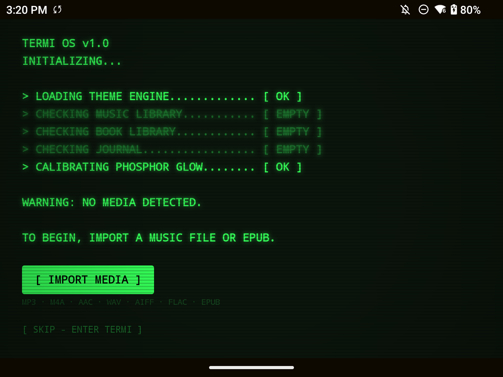

# Termi Android

The Android edition of Termi: a local music player, EPUB reader, journal, and package sharing app with a terminal interface, CRT effects, and gamepad navigation.

This is a beta for Android 12 and newer. Features are still being tested across devices.



## Install

Download the signed APK from this repository's Releases page, allow your browser or file manager to install apps, and open the APK. In Termi's file browser, grant **All files access** when prompted to browse your music and document folders.

Music plays directly from selected files. Imported EPUBs, journal documents, and received packages are stored in the app's private storage. Uninstalling Termi deletes that private storage. Automatic cloud/device backup is disabled; keep your source files and copy important journal documents out before uninstalling. Beta releases use the same app ID and release signing key so updates preserve app data.

Debug builds install separately as `com.termi.android.debug`.

## Features

- Local music library, playlists, metadata editing, audio visualizers, and sleep timer.
- Background playback, notification and lock-screen controls, audio focus, and headphone-disconnect handling for music and mixtapes.
- EPUB reading, bookmarks, reading progress, statistics, and daily goals.
- Text/Markdown journaling with autosave, document groups, Pomodoro, and writing statistics.
- `.termi` packages containing mixtapes, book quotes, and journal notes.
- PIN-protected browser uploads and package exchange over the same local network.
- Terminal themes, CRT effects, and controller navigation.

Wi-Fi transfer accepts files up to 512 MiB. Archives must expand to at most 512 MiB; text entries are limited to 8 MiB. Transfers use local HTTP and require a trusted shared network. Cross-platform package exchange with iOS still needs the full two-device acceptance checklist.

## Build

Install JDK 17, Android SDK platform 36, and Android build tools. Set `ANDROID_HOME` or create an untracked `local.properties` with `sdk.dir=/path/to/Android/sdk`.

```sh
./gradlew assembleDebug lintDebug testDebugUnitTest
./gradlew connectedDebugAndroidTest  # requires a connected device or emulator
```

The debug APK is at `app/build/outputs/apk/debug/app-debug.apk`. CI runs builds, lint, unit tests, and Android regression tests on an emulator.

## Signed release

For your own fork, create a key once, then use the same key for every update:

```sh
python3 scripts/release.py --generate-key
# Subsequent releases:
python3 scripts/release.py
```

The first command creates an ignored `.release/` directory containing the keystore and credentials. **Back it up securely; losing it prevents signing compatible updates.** Never upload that directory to GitHub. The script builds, checks lint and unit tests, verifies APK signatures, and writes the APK plus `SHA256SUMS` into `dist/`.

An existing key or CI can instead supply `TERMI_KEYSTORE_PATH`, `TERMI_KEYSTORE_PASSWORD`, `TERMI_KEY_ALIAS`, and `TERMI_KEY_PASSWORD`. See [release checklist](docs/RELEASE_CHECKLIST.md) for the publishing workflow and required device checks.

## Known limitations

Volume normalization and sleep-timer fade-out are not implemented. Last.fm, custom fonts/typewriter sounds, custom themes, annual recap, and the iOS tablet workspace are outside this first Android beta. External file permission and codec behavior can differ on custom Android ROMs. See [release checklist](docs/RELEASE_CHECKLIST.md) for current validation status.

## License

[MIT](LICENSE). The license covers this source code; imported music, books, and other user content retain their own rights.
